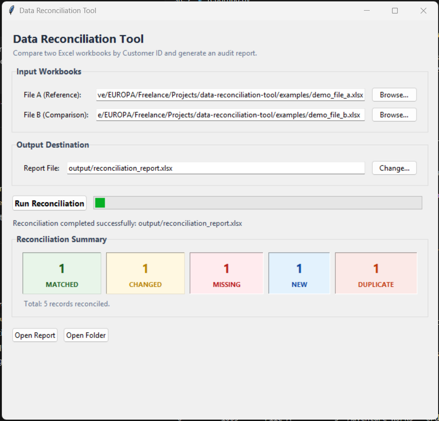
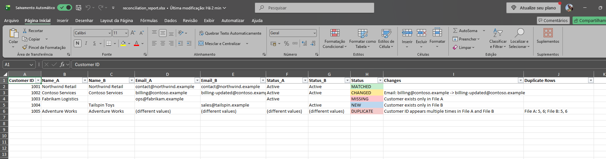
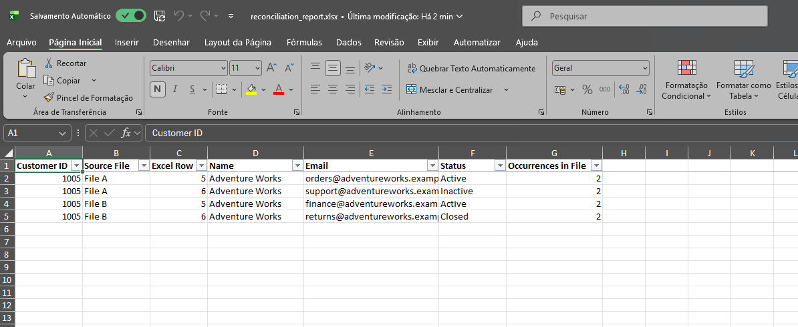

# Data Reconciliation Tool

A professional Python desktop utility that compares two Excel (`.xlsx`) workbooks by `Customer ID` and produces a formatted reconciliation audit report with automated duplicate handling.

Built as a portfolio project for data operations, application support, finance, and business workflows where teams need to identify matching, changed, missing, new, or duplicated customer records without slow and error-prone manual spreadsheet comparison.

**GitHub Repository:** [fabiano-sardinha/data-reconciliation-tool](https://github.com/fabiano-sardinha/data-reconciliation-tool)

## Screenshots

### Desktop Application Interface
Responsive Tkinter/ttk desktop interface featuring independent file selectors, live progress feedback, and real-time reconciliation metric cards:



### Main Reconciliation Report
Formatted Excel workbook featuring frozen headers, auto-filters, column auto-sizing, and status-based conditional formatting:



### Duplicate Details Worksheet
Dedicated audit tab tracking every occurrence of repeated Customer IDs with original Excel row numbers and source files:



## Key Features

- **Automated Two-Way Reconciliation:** Compares two Excel workbooks (`.xlsx`) using `Customer ID` as the unique record identifier.
- **Five Reconciliation Outcomes:** Categorizes every record as `MATCHED`, `CHANGED`, `MISSING`, `NEW`, or `DUPLICATE`.
- **Granular Field-Level Audit:** Identifies exact value differences across `Name`, `Email`, and `Status`, distinguishing empty fields from populated values.
- **Safe Duplicate-ID Handling:** Prevents artificial Cartesian row combinations by isolating repeated keys and recording every occurrence with its source file and row number.
- **Professional Excel Reporting:** Exports a formatted workbook with auto-filters, frozen panes, custom column widths, and color-coded status highlights.
- **Robust Input Validation:** Verifies file existence, required column headers, and non-empty key values before processing to prevent partial or corrupted outputs.

## The Problem It Solves

Manual spreadsheet reconciliation is slow and error-prone, especially when files contain missing records, changed values, or repeated identifiers.

This tool compares two `.xlsx` files using `Customer ID` as the record key and creates an Excel report that highlights the result for each ID. It also handles duplicate IDs safely: duplicated records are not forced into artificial A/B matches, so no occurrence is silently discarded.

## Reconciliation Results

| Status | Description |
|---|---|
| `MATCHED` | Record exists in both files and the tracked values match |
| `CHANGED` | Record exists in both files but one or more tracked values differ |
| `MISSING` | Record exists only in File A |
| `NEW` | Record exists only in File B |
| `DUPLICATE` | Customer ID appears more than once in File A, File B, or both |

Records that exist in both files are compared using `Name`, `Email`, and `Status`. A missing value is displayed as `(empty)` in a change description.

## Duplicate-ID Handling

Duplicate IDs require special handling. A regular merge between repeated IDs can create artificial A/B record combinations and hide the original data structure.

For every duplicated Customer ID, the tool:

1. Excludes that ID from the record-to-record comparison.
2. Creates one summary row in the main report with status `DUPLICATE`.
3. Lists the source file and Excel row number of every occurrence.
4. Adds every occurrence to the `Duplicate Details` worksheet.
5. Uses `(different values)` in a summary field when the occurrences within one source file do not agree.

This preserves all duplicated records and avoids implying that unrelated repeated rows are direct matches. Repeated rows with identical values are still reported as duplicates.

## Input Requirements

The supported input format is Excel `.xlsx`. The application validates that input files use the `.xlsx` format and displays a clear message if an unsupported or legacy format (such as `.xls`) is selected.

The first worksheet is read, and the first row must contain these exact column names:

| Column | Purpose |
|---|---|
| `Customer ID` | Record identifier used for reconciliation; must not be empty |
| `Name` | Compared between File A and File B |
| `Email` | Compared between File A and File B |
| `Status` | Compared between File A and File B |

Additional columns are allowed but are not included in the reconciliation rules.

## Output

The application writes the report by default to:

```text
output/reconciliation_report.xlsx
```

> [!NOTE]
> A custom output destination path can also be chosen directly in the desktop interface.

The main worksheet contains:

| Column | Description |
|---|---|
| `Customer ID` | Identifier used to reconcile records |
| `Name_A`, `Name_B` | Name from File A and File B |
| `Email_A`, `Email_B` | Email from File A and File B |
| `Status_A`, `Status_B` | Source status values |
| `Status` | Reconciliation outcome |
| `Changes` | Field-level changes or duplicate explanation |
| `Duplicate Rows` | Source file and Excel row numbers for duplicated IDs |

When duplicates are found, the report also contains a `Duplicate Details` worksheet with one row per occurrence: Customer ID, source file, Excel row, Name, Email, Status, and the number of occurrences in that source file.

The output folder is created automatically when needed. A report with the same filename is overwritten.

## Example Files

The [`examples`](examples/) directory contains fictional workbooks that demonstrate all five reconciliation outcomes, including duplicate ID `1005` in both input files.

- [Demo File A](examples/demo_file_a.xlsx)
- [Demo File B](examples/demo_file_b.xlsx)
- [Generated reconciliation report](examples/demo_reconciliation_report.xlsx)

Regenerate the example files and report from the project root with:

```powershell
.\.venv\Scripts\python.exe examples/generate_examples.py
```

The script writes only to the `examples` directory.

## Quick Start

### Prerequisites

- Python 3.14 was used during project validation
- Tkinter, included with the standard Windows Python installer
- `pandas`
- `openpyxl`
- `pytest` for automated tests

### Installation

Clone the repository and enter the project folder:

```powershell
git clone https://github.com/fabiano-sardinha/data-reconciliation-tool.git
cd data-reconciliation-tool
```

Create and activate a virtual environment:

```powershell
python -m venv .venv
.\.venv\Scripts\Activate.ps1
```

Install dependencies:

```powershell
python -m pip install -r requirements.txt
```

### Run the Application

From the project root:

```powershell
python src/main.py
```

A desktop interface opens allowing you to select File A, File B, and an optional destination path. Clicking **Run Reconciliation** executes the analysis in the background without freezing the UI, displays a summary of reconciliation counts (Matched, Changed, Missing, New, Duplicate), and enables one-click buttons to open the generated report and containing folder.

## Validation and Quality Checks

### Permanent automated test suite

The repository contains a pytest suite covering reconciliation statuses, field-level changes, empty-value rules, input validation, report generation, duplicate-ID scenarios, application exit codes, and graphical user interface components.

Latest recorded result:

```text
106 passed
```

Run the permanent test suite from the project root with:

```powershell
python -m pytest
```

### Independent volume check

An additional one-off volume validation was run outside the permanent pytest suite using files with approximately 10,000 records.

- 18 integrity checks passed
- The Excel report was generated in approximately 4.28 seconds

This was a targeted validation scenario, not a general performance guarantee or benchmark across all machines, workbook structures, and data distributions.

## Error Handling

Expected input problems are reported clearly, including:

- Missing input files
- A selected path that is a folder rather than a file
- Missing required columns
- Empty `Customer ID` values

In the graphical user interface, expected validation problems are surfaced in clear, friendly error dialogs without Python tracebacks, and input fields remain available for correction. In scripted or headless execution, expected errors are printed to `sys.stderr` and exit with code `1`.

When input validation fails, the application stops before writing a new report. An existing report is not deleted.

Unexpected problems, such as unreadable workbooks or files locked by another application, are reported as errors with explanatory messages.

## Project Structure

```text
data-reconciliation-tool/
├── docs/
│   └── images/
│       ├── duplicate-details.png
│       ├── reconciliation-gui.png
│       └── reconciliation-report.png
├── src/
│   ├── gui.py           # Tkinter/ttk desktop GUI and background execution
│   ├── main.py          # Application entry point and predictable error handling
│   ├── reconcile.py     # Reconciliation and duplicate-ID workflow
│   ├── reporting.py     # Excel report creation and formatting
│   ├── rules.py         # Status and field-change rules
│   └── validation.py    # Input validation and duplicate detection
├── tests/
│   ├── conftest.py
│   ├── test_duplicates.py
│   ├── test_gui.py
│   ├── test_main.py
│   ├── test_reconcile.py
│   ├── test_rules.py
│   └── test_validation.py
├── requirements.txt
├── pytest.ini
└── README.md
```

## Current Limitations

- Only `.xlsx` files are supported. Legacy `.xls` workbooks are not supported and require conversion to `.xlsx` before reconciliation.
- Only the first worksheet in each input workbook is read.
- Required column names must match exactly.
- Comparisons are exact: the tool does not trim whitespace, normalize values, or ignore capitalization.
- Dependency versions are not pinned.
- The interface is a desktop Tkinter/ttk application; there is no command-line argument interface or web interface.
